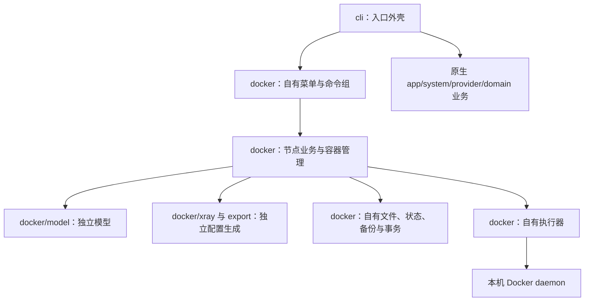

# Xray Docker 独立模块开发设计

本文记录 ProxyForge Xray Docker 功能的模块边界、设计约定和验收条件。独立模块、主界面、CLI、配置、Compose 生命周期及模拟测试已实现；本文的文件拆分和接口草案用于解释职责，实际接口以代码为准。操作入口见 [使用指南](docker-xray.md)。真实 Docker、官方镜像和端到端代理连接仍需在具备环境的 Linux 主机完成验收。

## 1. 目标与范围

ProxyForge 在 Linux 宿主机运行，以独立模块维护一个自行创建的 Xray Compose 实例。主界面增加「Xray（Docker）」入口，与原生 Xray、sing-box 并列。

本方案按完全独立实现：所有 Docker 业务代码放在 `internal/docker/` 及其子包中，不调用原有 `app`、`system`、`provider`、`domain` 的业务函数。配置生成、修改、凭据、证书、状态、备份、回滚和导出也由该模块自己实现。仅复用 Go 标准库、已有第三方通用库和主界面的入口外壳。

固定约定：

| 项目 | 设计值 |
| --- | --- |
| 配置内核 | `xray` |
| 部署实例标识 | `xray-docker` |
| Compose 项目名 | `proxyforge-xray` |
| Compose 服务名 | `xray` |
| 容器名称 | `proxyforge-xray` |
| 部署目录 | `/opt/proxyforge/xray-docker` |
| 镜像来源 | `ghcr.io/xtls/xray-core` |
| 网络模式 | `host` |
| 配置模式 | 单个 JSON，显式通过 `run -config` 加载 |

首版交付包括：

- 环境检测、指定版本镜像准备、首次部署、版本升级与失败回滚。
- REALITY/TLS 节点生成、配置查看和编辑、DNS、日志级别、出站 IP、回落设置。
- 受管节点凭据重置、访问控制、落地接入、中转线路、客户端导出。
- 容器启动、停止、重启、运行状态、历史和实时日志。
- 实例级数据隔离、配置备份、事务恢复、容器移除与残留清理。
- 原生 Xray 和 sing-box 的现有功能保持兼容。

首版不接管已有任意容器，不自动安装 Docker，不支持远程 daemon、rootless Docker、Docker Desktop、桥接网络、多实例和多文件合并配置。Docker 的稳定版、官方 `latest` 标签和指定版本渠道独立保存；开发版渠道在确认官方镜像标签规则后另行扩展。原生渠道逻辑保持原样。

## 2. 现有代码与接入边界

| 位置 | 当前行为 | 本方案处理方式 |
| --- | --- | --- |
| `internal/provider/xray/`、`internal/provider/provider.go` | 原生配置渲染、修改和内核接口 | 保持原样；Docker 配置实现位于模块自己的 `xray/` 子包 |
| `internal/app/app.go`、`generate.go`、`config_io.go` | 原生业务、服务和配置应用 | 保持原样；不增加 Docker 运行后端，不注入 Docker Runner |
| `internal/app/client.go`、`tls_cert.go`、`links.go`、`access_policy.go` | 原生客户端、证书、线路和访问控制 | 保持原样；Docker 模块独立实现对应业务 |
| `internal/system/`、`internal/domain/` | 原生系统操作、存储和数据类型 | 保持原样；Docker 不导入这些包 |
| `internal/cli/edit.go` | 原生手动配置编辑 | 保持原样；Docker 使用自己的候选编辑流程 |
| `internal/app/lifecycle.go` | 原生安装、卸载和残留清理 | 原生安装/卸载流程保留；仅收紧全局清理的根目录删除边界 |
| `internal/cli/menu.go` | 第三项为清理 | 增加第三项 Docker 入口，清理移到第四项；调用 Docker 模块的菜单和状态入口 |
| `internal/cli/root.go` | 注册现有命令 | 注册由 Docker 模块自己构建的 `docker` 命令组 |

`xray-docker` 是 Docker 模块的固定部署标识，代理协议内核仍为 Xray。Docker 模块有自己的节点模型和 schema，不使用原生 `domain.NodeSpec`；现有 Provider Registry 不增加 Docker 注册项。

「完全独立」指业务实现、包依赖和受管数据独立。菜单注册与全局清理协调需要少量接入改动；这些接入不能改变原生节点生成、配置修改、凭据和导出行为。独立实现不等于零共享运行资源：host 网络和 Docker daemon 仍可能因端口冲突或主机故障影响服务运行。

## 3. 独立模块与依赖边界

### 3.1 文件组织

建议新增：

```text
internal/docker/
├── manager.go           # 模块对外入口、选项和依赖注入
├── menu.go              # Docker 专属交互菜单与表单
├── commands.go          # docker 命令组及参数定义
├── prompt.go            # 输入、确认、取消和编辑器交互
├── environment.go       # 自有 root/Linux/Docker/Compose 检测
├── runner.go            # 自有命令与流式执行器
├── paths.go             # 模块固定路径及测试根目录
├── files.go             # 原子写入、摘要和文件元数据恢复
├── state.go             # 自有节点、策略、线路与偏好存储
├── backup.go            # 备份快照与保留策略
├── permissions.go       # 自有目录、配置和证书权限管理
├── compose.go           # Compose 渲染、检查与命令参数
├── image.go             # 镜像版本、拉取、digest 与能力检测
├── status.go            # inspect 解析和状态分类
├── lifecycle.go         # 准备、部署、升级、移除
├── config.go            # 节点生成、配置应用和候选编辑
├── keys.go              # UUID、short ID、REALITY 密钥及输出解析
├── tls.go               # 自签证书、指纹、轮换和路径映射
├── network.go           # target、SNI、地址与端口校验
├── dns.go               # DNS 设置与宿主机 resolver 读取
├── access.go            # 访问控制业务
├── links.go             # 落地接入与中转线路业务
├── client.go            # 客户端导出及校验
├── validate.go          # 临时容器校验执行
├── logs.go              # 历史与实时日志
├── transaction.go       # 配置/升级事务、锁与恢复记录
├── recovery.go          # 中断后的幂等恢复
├── cleanup.go           # 自有资源清理与全局清理预检查接口
├── model/
│   ├── types.go         # 自有 Node、Policy、Landing、Relay 等模型
│   └── validation.go    # 自有配置字段与业务规则校验
├── xray/
│   ├── render.go        # 独立的 Xray 服务端和客户端 JSON 渲染
│   ├── patch.go         # 独立的受管节点、DNS、日志与路由修改
│   └── access.go        # 独立的访问控制和回落规则生成
├── export/
│   └── mihomo.go        # 独立的 Mihomo/Clash Meta YAML 导出
└── templates/
    └── compose.yaml.tmpl

internal/cli/docker.go   # 可选薄接入：注册命令与转入模块菜单
```

文件可随实际实现合并，但职责边界应保持。

### 3.2 依赖方向



约束：

- `internal/docker/...` 的生产代码和测试代码均不得直接或间接导入原有 `internal/app`、`system`、`provider`、`domain`、`install` 或 `selfupdate`。也不得通过 CLI 回调间接调用这些包的管理函数。
- Docker 的菜单、命令、输入校验、配置业务和容器操作均在该目录中；外部 CLI 只注册、转发与显示模块返回的状态。
- 不复用原生的 `StateStore`、`Layout`、`AtomicWrite`、`ServiceManager`、Runner、TLS/网络校验、配置 Renderer、凭据解析或数据模型。
- Docker 模块允许依赖 Go 标准库和现有 Cobra 等第三方通用库；模块子包不能形成循环依赖。
- `docker/model` 是底层包；配置渲染子包仅依赖自有 model 和通用库，不访问文件或运行容器。
- 模块 Manager 编排全部 Docker 业务；原生 app 不持有 Docker 后端，也不增加通用 deployment 抽象来重构原生流程。
- 宿主机目录、时钟、命令执行器和健康探测可注入，方便测试。
- Manager 操作返回结构化结果；进度通过自有接口传递。自有菜单/命令层负责交互，底层业务不直接读取终端。
- 不通过替换全局 Runner、环境变量或修改 Registry 来暗中切换部署目标。

这种边界有意接受两套配置与管理实现的维护成本。原生功能修复不会自动进入 Docker，Docker 功能修复也不会自动改变原生；相同能力分别通过原生和 Docker 验收确认。

### 3.3 接口草案

以下表示接口职责，具体命名可根据实现调整：

```go
type Options struct {
    Root       string // 仅由本模块解析路径，测试默认使用临时目录
    Runner     Runner // 本模块定义，默认实现为自有 ExecRunner
    Out        io.Writer
    ErrOut     io.Writer
    Now        func() time.Time
}

type Runner interface {
    Run(context.Context, string, ...string) ([]byte, error)
    RunStreaming(context.Context, io.Writer, io.Writer, string, ...string) error
}

type Manager struct {
    // 全部依赖来自 internal/docker 的实现或自有接口。
}

func New(Options) *Manager
func (m *Manager) Menu(context.Context, io.Reader) error
func (m *Manager) Command() *cobra.Command
func (m *Manager) Status(context.Context) (Status, error)
func (m *Manager) Prepare(context.Context, PrepareOptions) error
func (m *Manager) Deploy(context.Context, model.GenerateOptions) error
func (m *Manager) Upgrade(context.Context, UpgradeOptions) error
func (m *Manager) ApplyConfig(context.Context, Candidate) error
func (m *Manager) Remove(context.Context) error
func (m *Manager) CheckCleanup(context.Context) error
func (m *Manager) Cleanup(context.Context) error
func (m *Manager) Recover(context.Context) error
```

`Status` 至少表达存在、运行、暂停、重启中、退出码、重启次数、启动时间、容器 ID、实际镜像 ID和诊断错误。不能用 `Active=false` 同时表达「已停止」与「Docker 不可达」。

所有示意类型都归属于 Docker 模块或其子包；不暴露原生 app/system 类型。`Deploy` 接收自有节点参数，在模块内部创建节点模型、生成配置并执行部署。`Candidate` 封装候选配置、自有节点/策略/线路状态及预期端口。

版本和密钥输出解析在模块内部实现。模块对核心命令、配置校验和 Compose 使用明确的执行方法，不能通过匹配任意命令字符串重写原生系统命令。CLI 创建 Manager 时不得传入 `c.app.Runner` 或 `system.ExecRunner`；默认执行器由模块自己创建。

### 3.4 独立业务的实现要求

独立实现需完整覆盖声明的能力，不能通过返回占位结果来绕过原生函数依赖：

| 能力 | Docker 模块负责实现的内容 |
| --- | --- |
| 节点与凭据 | 自有参数默认值、字段校验、UUID、short ID、密钥输出解析、凭据保留和轮换 |
| 配置生成 | VLESS + RAW + REALITY/TLS + Vision、主入站、回落防护、出站和默认路由 |
| 局部修改 | 识别自有受管标签/用户；更新受管字段，保留不相关 JSON；不唯一时拒绝修改 |
| 网络检查 | REALITY target 格式、DNS、禁止地址、服务器自身地址、TCP/TLS/SNI 证书检查；IPv4/IPv6 探测与取消 |
| DNS与出站 | 自有 DNS 方案及 resolver 读取，IPv4/IPv6 偏好与仅某地址族，回落策略 |
| 访问控制 | 自有策略模型、域名/IP/CIDR 校验、白名单/黑名单优先级、仅允许白名单模式与回落限制 |
| 线路 | 独立保存落地、中转、启用状态和上游信息，生成及 patch 自有规则和标签 |
| TLS | 标准库生成自签证书，自有证书/公钥指纹、文件映射、轮换和失败恢复 |
| 导出 | 自有普通/中转节点配置，Xray JSON 和 Mihomo/Clash Meta YAML；TLS 固定指纹校验 |

默认阻断的私网、本机、保留网段和策略优先级在模块中自己定义并测试，不调用原生域模型的 CIDR 列表或策略校验。REALITY target 校验不得因为模块独立而放宽原来的地址和证书要求；明确的访问白名单例外只作用于代理请求的访问策略。

这些行为可以参考现有使用文档作为功能要求，代码、模型、配置样本和测试独立维护。Mihomo 导出不能调用现有 `provider/mihomo`。Docker 管理员导出是显式操作，常规进度和错误日志仍不输出完整配置或私钥。

## 4. 运行环境与依赖检测

首版支持项目已有的 Linux amd64/arm64 环境，在本机 rootful Docker 上运行，使用 Compose v2 或更高版本插件（含 v5）的 `docker compose`。

检测顺序：

1. 保留现有 root 权限要求；帮助与版本查询例外。
2. 校验 Linux 和架构。
3. 检查 `docker` 与 `docker compose version`。
4. 通过本机 socket 访问 daemon，检查权限与可达性。
5. 检查存储目录可写、镜像平台匹配和受管资源归属。

环境检测在模块自己的 `environment.go` 中实现，包括 root、Linux、架构、daemon 和 Compose。Docker 检测不要求存在宿主机 Xray 二进制或 `xray.service`，也不检查 PID 1 是否为 systemd。原生安装继续使用现有环境检查。

所有 Docker 命令显式指定 `--host unix:///var/run/docker.sock`，避免受 `DOCKER_HOST`、context 和调用目录影响。环境检测失败应区分：Docker 未安装、Compose 缺失、daemon 不可达、socket 权限不足、当前运行模式不支持。

菜单中 Docker 依赖不可用时仍显示入口和诊断状态；不能使整个主界面失败。首版给出依赖缺失信息，不执行 Docker 安装脚本或修改 daemon 设置。

## 5. 文件布局、权限与状态隔离

### 5.1 部署文件

```text
/opt/proxyforge/xray-docker/
├── compose.yaml
├── config/
│   └── config.json
└── tls/
    ├── main-<随机值>/
    │   ├── cert.pem
    │   └── key.pem
    └── <落地接入名>/
        ├── cert.pem
        └── key.pem
```

候选文件放在实例专属 staging 目录，禁止编辑或校验时直接覆盖正式配置。临时容器显式挂载候选文件；校验完成后删除临时文件。

### 5.2 管理数据

| 用途 | Docker 实例路径 |
| --- | --- |
| 节点状态 | `/var/lib/proxyforge/docker/xray/state.json` |
| 访问控制 | `/var/lib/proxyforge/docker/xray/access.json` |
| 落地接入 | `/var/lib/proxyforge/docker/xray/landings.json` |
| 中转线路 | `/var/lib/proxyforge/docker/xray/relays.json` |
| 版本偏好 | `/var/lib/proxyforge/docker/xray/preferences.json` |
| 部署元数据 | `/var/lib/proxyforge/docker/xray/deployment.json` |
| 目录归属标记 | `/var/lib/proxyforge/docker/xray/owner.json` |
| 配置与升级备份 | `/var/lib/proxyforge/docker/xray/backups/<timestamp>/` |
| 候选文件 | `/var/lib/proxyforge/docker/xray/staging/` |
| 事务恢复记录 | `/var/lib/proxyforge/docker/xray/transaction.json` |
| 并发锁 | `/run/proxyforge/xray-docker.lock` |

Docker 模块独立解析 `PROXYFORGE_ROOT` 或显式传入的测试 Root，通过自己的 `paths.go` 生成路径，不使用原生 Layout。执行真实 Docker 操作时，挂载源必须是 daemon 主机上的实际绝对路径，不能把仅供测试的根目录自动应用到生产实例。

权限约定：受管目录 `0700`，Compose、配置、管理 JSON、备份、证书和私钥 `0600`，默认 root 所有。部署目录的父目录需具备必要的访问权限。`files.go` 使用标准库独立实现同目录临时文件、写入、fsync、关闭、原子 rename 及父目录同步；不调用 `system.AtomicWrite`。恢复时保存原有 mode、UID、GID。

### 5.3 自有存储与协议模型

Docker 模块独立实现 StateStore、访问策略、线路和版本偏好的持久化。固定使用自己的根目录，不改原生 StateStore，不向原生状态文件写 Docker 节点。

模型与存储规则：

- `docker/model` 自己定义 Node、KeyPair、Policy、Landing、Relay、GenerateOptions 和导出模型，不导入 `domain`。
- Docker 状态采用自己的版本化封装，包含 `schema_version`、`managed_by`、`instance_id` 和节点/配置摘要。
- 状态的 `instance_id` 必须为 `xray-docker`，内核标识为 `xray`；加载时严格验证，拒绝错误类型、额外内容和不安全权限。
- Docker 状态 schema 与原生 schema 独立演进，不改变 `domain.StateSchemaVersion`。
- 多文件提交先记录旧快照，任一写入失败均恢复已经完成的写入；快照与恢复记录也由 Docker 模块管理。
- 原生历史文件不搬迁、不改格式；不自动导入原生凭据，两种 Xray 部署可以同时存在。

所有 Docker 操作仅访问自己的数据根目录和部署目录。状态、访问策略、线路、证书和备份必须一并隔离，不读取原生节点作为缺省值。

### 5.4 部署元数据

独立版本化 JSON，至少包含：

```json
{
  "schema_version": 1,
  "managed_by": "proxyforge",
  "instance_id": "xray-docker",
  "channel": "stable",
  "requested_version": "<选定版本>",
  "image_ref": "ghcr.io/xtls/xray-core@sha256:<已解析摘要>",
  "image_id": "sha256:<本机镜像ID>",
  "version": "Xray <选定版本> (...)" ,
  "compose_sha256": "<生成文件摘要>",
  "desired_state": "stopped",
  "updated_at": "<UTC时间>"
}
```

示例中的占位符由程序写入真实值。容器 ID 属于运行时信息，不能充当稳定实例标识。`desired_state` 在成功操作后更新，实际状态以 Docker inspect 为准。

`channel` 支持 `stable`、`latest`、`pinned`。选择 `latest` 时，直接拉取官方 `:latest` 并检测镜像实际内核版本；`requested_version` 保存检测到的具体版本，`version` 保存内核版本输出，Compose 仍固定为 digest。已准备的 latest 镜像可继续部署；只有主动升级重新拉取该标签。

## 6. Compose 模板

以下为 Go 模板，模板输入字符串由程序解析版本并拉取后填入官方仓库 digest 引用。实际生成文件没有模板占位符；代码中的内嵌模板采用等价的 YAML 列表格式。

```yaml
name: proxyforge-xray

services:
  xray:
    image: "{{ . }}"
    container_name: proxyforge-xray
    restart: unless-stopped
    network_mode: host

    command:
      - run
      - -config
      - /usr/local/etc/xray/config.json

    user: "0:0"
    read_only: true

    cap_drop:
      - ALL
    cap_add:
      - NET_BIND_SERVICE

    security_opt:
      - no-new-privileges:true

    volumes:
      - type: bind
        source: ./config
        target: /usr/local/etc/xray
        read_only: true
        bind:
          create_host_path: false

      - type: bind
        source: ./tls
        target: /etc/xray/tls
        read_only: true
        bind:
          create_host_path: false

    tmpfs:
      - /tmp:rw,noexec,nosuid,nodev,size=16m,mode=1777
      - /var/log/xray:rw,noexec,nosuid,nodev,size=16m,mode=0700

    logging:
      driver: json-file
      options:
        max-size: "10m"
        max-file: "3"

    stop_grace_period: 10s

    labels:
      io.proxyforge.managed: "true"
      io.proxyforge.core: "xray"
      io.proxyforge.instance: "xray-docker"
```

模板规则：

- 镜像输入限定在官方仓库，填入规范化后的 digest；普通启动不解析新版本、不拉取 `latest`。
- 官方镜像 ENTRYPOINT 为 Xray，默认 CMD 使用多文件目录；此处显式覆盖为单文件模式。[官方 Dockerfile](https://github.com/XTLS/Xray-core/blob/main/.github/docker/Dockerfile)
- 使用容器内 UID/GID `0:0`，配合仅保留 `NET_BIND_SERVICE`，兼容 root 所有的 `0600` 配置和 443 等低端口。镜像原本的 nonroot 默认被明确覆盖。[Compose 服务参数](https://docs.docker.com/reference/compose-file/services/)
- 使用 host 网络，实际端口取自 Xray 配置，不生成 `ports` 或自定义 networks。端口会与原生内核及其他宿主机服务共享。[host 网络文档](https://docs.docker.com/engine/network/drivers/host/)
- 配置使用目录挂载，保持原子替换后容器能按路径读取新文件。绑定源在部署前显式创建，缺失时失败。[bind mount 文档](https://docs.docker.com/engine/storage/bind-mounts/)
- `/var/log/xray` 使用临时内存挂载，覆盖镜像声明的日志 VOLUME，避免反复重建留下匿名日志卷；持久日志由 Docker logging driver 轮转。
- 生成的 Xray log 默认不指定文件路径，使用控制台日志；保留当前默认日志级别和访问日志策略。手动选择文件日志时说明其仅在容器运行期保留。
- 不在容器内放置 shell、curl 或外部健康探测程序；由 ProxyForge 在宿主机检查运行情况。
- 通过 `docker compose config --quiet` 检查渲染结果；这一步仅检查 Compose 结构，不能替代 Xray 校验与实际部署测试。

## 7. Compose 命令约定

所有命令通过本模块自有 Runner 使用参数数组调用。自有 ExecRunner 基于 `os/exec`，不使用原生 Runner 或 LoggingRunner。固定公共参数如下，实际代码不使用 shell 拼接：

```text
docker --host unix:///var/run/docker.sock compose
  --project-name proxyforge-xray
  --project-directory /opt/proxyforge/xray-docker
  --file /opt/proxyforge/xray-docker/compose.yaml
```

| 操作 | 公共参数后的命令 | 语义 |
| --- | --- | --- |
| Compose 检查 | `config --quiet` | 检查生成文件 |
| 启动/首次部署 | `up -d --no-deps --pull never xray` | 使用已准备镜像，创建或启动服务 |
| 停止 | `stop xray` | 保留容器和数据 |
| 重启配置 | `restart xray` | 重启已存在容器，不更换镜像 |
| 镜像/Compose 更新 | `up -d --no-deps --pull never --force-recreate xray` | 按新定义重建 |
| 升级已停止实例 | `up --no-start --no-deps --pull never --force-recreate xray` | 重建后保持停止 |
| 历史日志 | `logs --no-color --tail 100 xray` | 查看受管服务输出 |
| 实时日志 | `logs --no-color --tail 100 --follow xray` | Ctrl+C 结束日志跟随 |
| 移除实例 | `down` | 移除受管项目容器，保留宿主机文件 |

状态主要使用 `docker container inspect` 的 JSON，结合项目和受管 labels 判断归属，避免依赖人类可读输出格式。Compose 返回成功仍需进行运行核验。

升级需重建容器；单纯 `restart` 不应用镜像和 Compose 参数变更。[Compose up 文档](https://docs.docker.com/reference/cli/docker/compose/up/)

`down` 不加 `--rmi`、`--volumes` 或 `--remove-orphans`，不删除共享镜像、不扩大资源范围。Compose 文件、项目服务集合及实际容器归属必须先核验。[Compose down 文档](https://docs.docker.com/reference/cli/docker/compose/down/)

## 8. 镜像准备与首次部署

### 8.1 镜像准备

「准备镜像」与「启动代理」分别定义，避免没有节点配置时启动空容器。

1. 加实例锁，检查环境和同名资源。
2. 稳定版解析为明确发行版本；`latest` 直接拉取官方同名镜像标签，不查询 GitHub Releases API；指定版本规范化为镜像标签并检查存在性。不能未经确认直接假定 Release 标签和镜像标签一致。所有渠道均检测实际内核版本并固定 digest；`latest` 不额外过滤发布类型。
3. 拉取目标镜像，记录 repo digest、本机 image ID 和实际 Xray 版本。
4. 使用临时容器执行 `version`、`x25519` 和当前项目配置能力校验。
5. 创建目录、渲染 Compose、验证并原子保存部署元数据。
6. 成功后保存版本渠道；失败或取消不覆盖已有偏好。

此时无业务容器，菜单显示「待配置」。若已经存在活动实例，切换镜像必须走升级事务，不能直接覆写其 Compose。

### 8.2 首次部署

用户通过「部署/升级」首次进入时，默认连续完成镜像准备、节点参数填写、配置生成和启动；也可以退出配置流程，保留已准备镜像。

部署顺序：

1. Docker 自有菜单/命令收集参数，模块独立校验 REALITY target 或生成 TLS 证书。
2. 模块通过临时容器生成 REALITY 密钥，并独立生成 UUID 和 short ID，或使用自有 TLS 流程。
3. `docker/xray` 渲染候选 JSON，模块使用目标镜像校验。
4. 检查所有对外监听端口以及回落/落地端口，冲突时不停止其他服务。
5. 创建事务恢复记录，提交 Compose 和正式配置。
6. `compose up -d`，核验实例归属、镜像、稳定运行和预期端口。
7. 保存节点状态、策略、线路和部署元数据，事务完成后清除恢复记录。

失败时移除本次创建的业务/校验容器，恢复之前的准备状态和文件，只清理本次新生成且尚未受管的证书。旧数据和已拉取镜像可保留供重试，不能为了清理失败操作运行全局 prune。

## 9. 核心命令和候选配置校验

校验必须使用选定/实际运行的同一镜像版本，不能依赖宿主机安装的 Xray。

为停止状态也能校验，独立创建临时容器：

```text
docker --host unix:///var/run/docker.sock run --rm
  --name <实例前缀加随机值>
  --label io.proxyforge.managed=true
  --label io.proxyforge.instance=xray-docker
  --label io.proxyforge.role=validator
  --network host
  --user 0:0
  --read-only
  --cap-drop ALL
  --cap-add NET_BIND_SERVICE
  --security-opt no-new-privileges:true
  --mount type=bind,src=<候选文件绝对路径>,dst=/run/proxyforge/config.json,readonly
  --mount type=bind,src=<TLS目录绝对路径>,dst=/etc/xray/tls,readonly
  --tmpfs /tmp:rw,noexec,nosuid,nodev,size=16m,mode=1777
  --tmpfs /var/log/xray:rw,noexec,nosuid,nodev,size=16m,mode=0700
  <目标本机镜像ID>
  run -test -config /run/proxyforge/config.json
```

这是参数布局示意，实际通过参数数组传递。镜像必须已存在本机；禁止候选校验期间隐式更新镜像。TLS 目录提前创建；能力检测等不需要证书的场景可以省略该挂载。

关键要求：

- 临时容器只运行 Xray 子命令，使用相同用户、关键环境和证书/资源路径；首版自建实例资源来自固定镜像。
- 不在正式配置目录放置会被意外扫描的候选文件。
- 服务端、客户端导出配置、安装能力探测、手动编辑全部走此校验入口。
- 临时容器唯一命名；取消、超时或进程中断后，按精确 ID 和受管 labels 清理。
- 版本和密钥命令也可使用同一临时容器执行器，替换为 `version`、`x25519` 参数。
- `x25519` 输出由模块自己的 `keys.go` 解析，不输出到进度日志；配置失败输出限制长度，并避免泄露私钥和完整 JSON。
- `docker exec` 仅用于确认业务容器内的实际版本等运行期操作；不把它作为唯一校验方案，因为它要求容器处于运行状态。[Docker exec 文档](https://docs.docker.com/reference/cli/docker/container/exec/)
- 配置语法通过不代表代理链路已可用，后续仍需运行和连通性验收。

## 10. TLS 路径映射

状态和证书操作使用宿主机路径，例如：

```text
/opt/proxyforge/xray-docker/tls/main-abcd/cert.pem
/opt/proxyforge/xray-docker/tls/main-abcd/key.pem
```

渲染到 Docker Xray JSON 的路径为：

```text
/etc/xray/tls/main-abcd/cert.pem
/etc/xray/tls/main-abcd/key.pem
```

Docker 自有证书、客户端导出、备份和清理业务使用宿主机路径。仅在模块内部配置渲染/修改边界将受管证书路径映射到容器路径，不调用原生 TLS 函数。

更新 TLS 配置时，旧节点与新节点都先生成用于渲染的映射副本，保证自有节点和线路 patch 对旧路径的匹配正确。保存的节点状态不被映射副本覆盖。

路径映射必须验证路径在受管 TLS 根目录下，拒绝 `..` 越界和逃逸的符号链接。模块使用标准库独立完成证书生成、指纹计算、有效性检查与权限处理。TLS 轮换保留备份引用的旧证书；事务失败只删除本次新证书。

## 11. 配置应用、健康核验与恢复

### 11.1 实例锁

部署、配置写入、升级、停止/启动、移除和清理都使用同一实例互斥锁，锁从读取快照持续到事务完成。日志跟随不长期占锁。不能只锁文件替换步骤，让升级与配置写入交错执行。

### 11.2 普通配置修改

1. 检查实例归属与未完成事务，记录配置、状态、文件权限和实际运行状态。
2. 编辑/渲染候选副本，计算差异；无变化时不写入、不重启。
3. 用实际镜像校验候选配置，备份旧配置及关联状态。
4. 写事务记录，原子替换正式配置并确认权限。
5. 原来运行则重启并核验；原来停止则仅保存配置并保持停止。
6. 同步状态摘要与更新时间；手动编辑破坏受管字段时标记漂移，不能自动伪造节点凭据。
7. 全部成功后完成事务。

首次生成配置默认启动实例。已有停止实例的普通修改、凭据重置、线路和访问控制修改保持停止；用户通过服务入口显式启动。

Docker 自有节点、DNS、访问策略和线路业务统一调用模块内部的配置事务入口，不调用原生 app 的配置应用函数，不修改原生事务流程。

### 11.3 手动编辑

编辑 staging 副本，取消或编辑器异常不改变正式文件。校验失败可重新编辑，也可放弃；校验成功后通过普通配置事务提交。

手动修改后，配置与状态不匹配时保留明确的漂移状态。依赖受管凭据的重置、线路和客户端导出需验证字段一致性，无法识别时给出错误和修复入口。

### 11.4 运行核验

- 检查容器 ID、归属 labels、实际镜像和预期启动命令。
- 容器需持续处于 running，短暂运行后退出或进入 restarting 不算成功。
- 至少使用可配置的稳定观察窗口（建议 5 秒），观察退出码、启动时间和重启次数变化。
- 检查预期监听端口，包括主节点及启用的独立 TLS 落地端口；内部回落端口按功能检查。
- 端口检查必须结合实例运行状态，避免将其他服务占用端口误判为成功。
- 需要修改端口时，先停止本实例再检查；仅验证本实例端口，不能停止原生内核来释放端口。停止后若发生冲突，恢复旧实例。
- Docker 功能验收另行进行真实代理连接；菜单状态为运行中并不宣称完成了端到端网络检查。

### 11.5 失败与程序中断

事务记录至少包含类型、阶段、备份位置、旧/新配置与 Compose 摘要、旧镜像引用、旧运行状态、受管容器和临时资源标识。记录 root-only，不包含不必要的密钥副本。

使用「准备 → 文件已提交 → 运行已应用 → 状态已提交 → 完成」等明确阶段。记录必须在改变正式资源之前落盘；恢复操作应幂等。

应用失败时恢复配置、Compose、权限和节点/策略/线路状态，并恢复原来的运行或停止状态。旧版本运行无法恢复时，返回原始错误与每项回滚错误，保留恢复记录；不能打印「已恢复」来掩盖失败。

下次写操作前先恢复未完成事务。主菜单可以显示「需恢复」，但不能在只读状态查询时悄悄重启容器。

取消操作的恢复使用单独、有界的 cleanup context，不能使用已经取消的操作 context。第一次中断后尽力完成恢复；被强制终止则依赖事务记录进行下次恢复。

备份默认沿用最近 3 份的策略；事务正在引用的备份不得被轮转删除。升级期间保留旧镜像，至少到升级提交和恢复窗口结束，不自动删除共享镜像。

## 12. 镜像升级事务

升级流程：

1. 加锁，保存旧 Compose、配置、关联状态、镜像引用和运行状态。
2. 拉取选定新版本，记录 digest/image ID，检查 Xray 实际版本、密钥输出格式和当前配置能力。
3. 用新镜像校验现有服务端配置，必要时校验可导出的原生客户端配置。
4. 新版本不兼容则在停止旧实例前返回；不改变 UUID、密钥、证书和线路。
5. 备份并写升级恢复记录，提交新 Compose。
6. 原来运行：重建并检查稳定运行、端口和实际版本。原来停止：使用 `--no-start` 重建并确认仍停止。
7. 成功后提交部署元数据、节点 CoreVersion、版本偏好及文件摘要。
8. 失败则用本机旧镜像恢复旧 Compose，重建并恢复旧运行状态和全部关联状态。

旧镜像在本机不可用时，升级前应准备可用的回滚镜像；无法保证回滚时不进入破坏性切换。普通重启、配置修改和状态查看不访问镜像仓库。

指定版本和稳定版解析必须在升级入口显示清楚。首次镜像准备和升级不复用原生官方安装脚本及其信任文件；镜像渠道与原生安装渠道分别保存。

## 13. 主界面、Docker 菜单与命令

### 13.1 主界面

```text
╭─ ProxyForge
│ 双内核代理管理器  [版本 ...]
╰──────────────────────────────────────────────

  1   Xray-core           [已安装]
  2   sing-box            [已安装]
  3   Xray（Docker）      [运行中]

  4   清理全部卸载残留
  0/q 退出

❯ 请选择 [1]：
```

`selectCore` 中增加明确的 Docker 分支：数字 3 调用 Docker 模块自己的 Menu，返回后继续主界面；不把 Docker 伪装成原生 core 返回给 `coreMenu`。数字 4 清理；默认仍为 1，继续支持 `q` 和取消返回。原生选择返回类型可保留，不引入通用 Target 改造。

### 13.2 状态规则

| 实际情况 | 主界面显示 |
| --- | --- |
| Docker 未安装 | Docker 未安装 |
| Compose 缺失 | Compose 未安装 |
| daemon 无法访问 | Docker 不可用 |
| 没有元数据、Compose 和受管容器 | 未部署 |
| 镜像和 Compose 已准备，没有有效节点 | 待配置 |
| 保留有效配置，但业务容器已移除 | 已移除·数据保留 |
| 存在受管 stopped/exited 容器且符合停止状态 | 已停止 |
| 运行稳定且身份、配置定义符合预期 | 运行中 |
| restarting、异常退出、paused、同名非受管容器、文件漂移 | 异常，并在详情显示原因 |
| 存在待处理事务 | 需恢复 |

预期运行却异常退出不能显示正常「已停止」。不存在容器与 inspect/daemon 失败必须分别处理。

### 13.3 Docker 子菜单

```text
  1   部署/升级
  2   服务端配置
  3   客户端配置
  4   服务管理
  5   移除容器（保留配置和数据）
  6   清理卸载残留
  0/q 返回
```

状态卡显示 Xray 实际版本、容器名称、运行状态和监听端口。Docker 菜单、中文表单、确认、编辑器和取消操作在模块内独立实现，可以保持与原生入口相同的显示风格，不调用原生表单/业务函数。运行用户固定显示 `0:0`，不提供 systemd 专用用户迁移，也不为 Docker 创建宿主机 `xray` 系统账号。

### 13.4 CLI 草案

当前入口均位于独立的 `docker` 命令组，实际参数与子命令以 `--help` 和 [使用指南](docker-xray.md) 为准：

```bash
# Docker 专属生命周期
proxyforge docker prepare --version <版本>
proxyforge docker deploy --version <版本> [节点参数]
proxyforge docker upgrade --version <版本>
proxyforge docker status
proxyforge docker remove
proxyforge docker cleanup

# Docker 专属配置和服务命令
proxyforge docker config generate [节点参数]
proxyforge docker config client [导出参数]
proxyforge docker config access [子命令与参数]
proxyforge docker config landing [子命令与参数]
proxyforge docker config relay [子命令与参数]
proxyforge docker service status
proxyforge docker service restart
```

所有 Docker 功能归属 `proxyforge docker ...` 命名空间，命令定义与处理函数在 `internal/docker/commands.go` 中。原有 `config`、`service` 命令不增加 `--runtime docker`，也不转发到原生 app。首版固定一个 Docker 实例，不增加用户自定义实例 ID 参数。

保持已有命令的参数和默认原生行为。Docker 命令组自己实现 root 检查、交互确认和 `--yes` 行为，可以接收顶层解析出的布尔选项，但不调用原生确认函数。命令组使用自有 Manager 和 ExecRunner，输入输出通过 `io.Reader/io.Writer` 注入。`proxyforge update` 仍仅更新 ProxyForge 本身。

## 14. 移除、清理和资源归属

### 14.1 移除容器

先核验所有目标容器和 Compose 服务集合，再移除本模块容器。保留部署目录、节点状态、证书、备份和镜像，便于重新部署。原生内核卸载语义不因此变化。

容器名相同但缺少受管标签，或项目里出现额外服务时，报告冲突；不能默认认为同名资源属于 ProxyForge。

### 14.2 Docker 残留清理

仅在确认业务容器和本实例临时容器均不存在后，清理第 5 节列出的 Docker 实例文件。清理部署目录前检查固定路径、元数据归属、符号链接和实际挂载；不接受调用者传入任意删除路径。

清理不删除宿主机 Docker、其他容器、网络、命名卷或镜像，不调用 `docker system prune`。官方镜像可能被其他服务共享，首版不提供自动镜像删除。

daemon 不可达时不能证明容器已移除，应拒绝删除数据并报告原因。仅安装 Docker CLI 但 daemon 不可用同样属于检查失败。

### 14.3 全局清理

当前 `Cleanup("all")` 最后直接删除 `/var/lib/proxyforge`，因此必须扩展预检查：

1. 顶层 CLI 协调原生模块的只读清理检查，确认 Xray、sing-box 已卸载；这些原生检查仍由原生 app 完成，Docker 模块不参与。
2. 顶层 CLI 调用 `docker.Manager.CheckCleanup`，由 Docker 模块自行确认业务与临时容器已移除。
3. 全部检查通过后分别调用各模块的清理入口；Docker 只删除第 5 节的自有路径。

为保证边界，原生 `Cleanup("all")` 取消对共享 `/var/lib/proxyforge` 的整体递归删除，保留整个 `docker/` 命名空间。其他原生数据和自定义残留沿用原有全局清理语义，处理后仅尝试删除空公共目录。原生只读 `CheckCleanup` 接口供 CLI 先检查；它不引用 Docker 包、不执行 Docker 命令。原生单独卸载与清理不能触碰 `/var/lib/proxyforge/docker/` 或 `/opt/proxyforge/xray-docker/`。

全局协调是入口外壳的职责；Docker 的实际检查、删除、归属校验与错误处理仍全部在模块内部。`BeginCleanup` 返回模块自己的清理 lease，让入口在原生清理期间持有 Docker 实例锁；模块不回调原生业务。两个清理入口在真正删除前再次核验自己的前置条件，归属标记也纳入预检查，防止先删除原生数据后才发现 Docker 数据不可清理。

Docker 根本未安装且没有该模块元数据、目录和恢复记录时可视为未启用；一旦存在受管记录而无法核验，拒绝全局清理。检测到安装的 daemon 不可达时也不能跳过 Docker 检查。

所有预检查必须先于任何删除；检查失败时不得先清理其他实例的数据。清理后如需刷新 systemd，只用于原生清理流程。

## 15. 测试与验收

已实现模拟 Docker 的单元测试及原生回归检查。下列包含已覆盖的单元行为和发布前仍需完成的真实运行验收；模拟执行器不安装 Docker、不拉取镜像、不启动容器。

### 15.1 模块测试

- Compose 渲染固定项目、服务、镜像、挂载和日志参数，正式文件不残留模板变量。
- 命令参数数组包含明确 daemon、项目、文件和服务；特殊字符路径不经 shell 执行。
- 环境缺失、daemon 不可达、非本地/rootless 模式和镜像架构不匹配分别报错。
- inspect 区分 missing、stopped、running、restarting、paused、异常退出和解析失败。
- 同名外部容器、额外 Compose 服务、错误标签和挂载漂移拒绝生命周期修改。
- 版本、密钥、服务端、客户端候选校验均不依赖宿主机 Xray。
- 临时校验容器超时和中断后精确清理，不输出密钥结果。
- 对 `internal/docker/...` 的生产和测试依赖进行静态检查，禁止直接或传递依赖原有 `app/system/provider/domain/install/selfupdate`；防止通过适配器或测试助手引入原生实现。
- 自有 ExecRunner、原子写入、状态序列化、备份、权限和配置渲染可以脱离原生 app/system 运行，测试不使用原生 fake Runner、Layout 或测试辅助函数。
- 自有 Xray JSON 和 Mihomo YAML 与已选择镜像/客户端格式兼容；配置 renderer 的 golden 数据独立维护。

### 15.2 业务与事务测试

- Docker 自有 Node 的协议内核仍为 Xray，模型不依赖原生 NodeSpec；状态、策略、线路、偏好、证书和备份互不覆盖。
- 验证旧原生 schema 和默认 CLI 行为兼容，Docker 状态升级不改变原生 schema。
- 手动编辑无变化、取消和语法失败不覆盖正式配置。
- 运行实例修改成功会重启，停止实例修改成功保持停止。
- TLS 宿主机/容器路径映射、旧路径 patch、指纹校验、轮换与失败清理正确。
- 分别注入校验、备份、写配置、重启、健康检查和保存状态失败，检查旧文件、权限、状态和运行状态恢复。
- 升级失败恢复旧镜像；停止实例升级保持停止，渠道仅成功后更新。
- 两个并行写操作互斥；恢复记录覆盖每个事务阶段和幂等重试。
- 全局清理的任一检查失败时不删除任何实例数据；外部容器/镜像不受影响。

### 15.3 真实 Docker 验收

使用一次性 Linux VM，显式启用 Docker 集成验收，采用独立测试项目名、容器名前缀、临时目录和可用端口。生产固定名称不得用于自动测试。

建议在 `internal/docker/integration/` 增加显式启用的真实 Docker 验收，测试代码与资源都位于模块目录，覆盖：

1. 宿主机未安装 Xray 时完成准备、首次 REALITY/TLS 部署、客户端导出和实际连接。
2. 检查 443 绑定能力与高端口部署，原生/其他服务占用端口时拒绝部署。
3. 修改配置后容器确实读到新文件，配置与证书目录保持只读。
4. Docker 日志可查看和跟随，日志轮转参数符合模板。
5. DNS、IPv4/IPv6 出站、回落、访问策略、独立 TLS 落地端口及中转线路运行有效。
6. 停止后校验和修改不自动启动，显式启动恢复运行。
7. 兼容版本升级、错误配置/启动失败回滚、停止实例升级、程序中断后的恢复。
8. 移除保留数据，重新部署沿用凭据；残留清理不触碰其他容器与原生配置。
9. amd64 与 arm64 镜像、Compose 和配置能力一致。
10. Docker 自动启动且实例未被手动停止时，重启 VM 后服务恢复；手动停止行为符合 `unless-stopped`。

依赖 Docker 的真实测试默认不运行；普通 `go test ./...` 使用 fake Runner 和临时根目录。验收脚本退出时只清理自身资源，禁止全局 prune。

### 15.4 发布完成条件

- 现有 `go test ./...`、`go vet ./...` 与 amd64/arm64 构建通过。
- 新模块依赖边界、事务、隔离、独立配置渲染和归属测试通过。
- 至少完成一次真实 Docker 的 REALITY、TLS、升级回滚和清理验收；其他架构未验收时明确记录。
- README、安装指南、配置指南、安全指南、开发指南及命令帮助同步更新实际已实现功能。
- 主界面新增入口可用，所有声明支持的配置功能均由 Docker 自有业务完成，原生 app/system/provider/domain 未成为模块依赖。

## 16. 建议实施顺序

| 阶段 | 主要工作 | 阶段验收 |
| --- | --- | --- |
| 1 | `internal/docker` 自有模型、路径、执行器、文件/状态/备份与依赖边界检查 | 不导入原生业务；Docker 存储独立；原生文件无改动 |
| 2 | 自有配置渲染、凭据/TLS/网络校验、模板、镜像准备与候选校验 | 无宿主机 Xray 可校验；准备镜像不启动空实例 |
| 3 | 首次部署、服务、日志、配置事务和 TLS 路径映射 | REALITY/TLS 部署与修改成功；失败正确回滚 |
| 4 | 自有 DNS、访问控制、落地、中转、客户端 JSON/YAML 导出 | Docker 版独立业务达到声明功能范围 |
| 5 | 升级、恢复记录、移除、独立清理与全局清理 | 保留旧镜像可回滚；数据和外部资源边界正确 |
| 6 | 菜单/CLI 完整接入、真实 Docker 验收和用户文档 | 达到发布完成条件 |

当前独立实现、菜单、CLI 和模拟回归已落地，阶段 6 的真实 Docker/镜像/连接验收仍待完成。只有这些验收通过后才能宣称 Docker 功能完整运行验收通过。所有 Docker 实现位于 `internal/docker/`，外部只有菜单/命令注册和清理协调；不建立原生与 Docker 共用的业务后端。原生清理对共享根目录的递归删除已收紧，这是保护 Docker 数据所需的接入改动。

## 17. 官方参考

- [Xray Docker 安装与镜像布局](https://xtls.github.io/document/install)
- [官方镜像 Dockerfile](https://github.com/XTLS/Xray-core/blob/main/.github/docker/Dockerfile)
- [Compose 服务字段](https://docs.docker.com/reference/compose-file/services/)
- [Docker bind mounts](https://docs.docker.com/engine/storage/bind-mounts/)
- [Docker host networking](https://docs.docker.com/engine/network/drivers/host/)
- [Compose up](https://docs.docker.com/reference/cli/docker/compose/up/)
- [Compose down](https://docs.docker.com/reference/cli/docker/compose/down/)
- [Docker exec](https://docs.docker.com/reference/cli/docker/container/exec/)

引用内容核对日期：2026-10-13。实现时对实际选定镜像版本检查启动参数、能力和路径，不以官方 main 分支代替发布镜像验收。

[返回文档目录](README.md)
